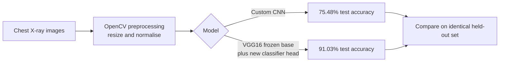
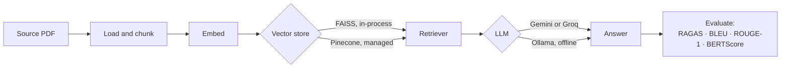
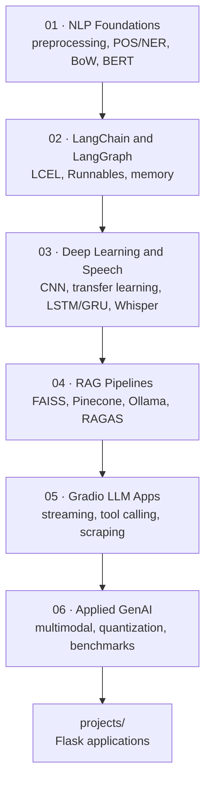

<h1 align="center">Machine Learning, Deep Learning &amp; Generative AI Portfolio</h1>

<p align="center">
  <strong>Nithish Kumar M S</strong> — AI/ML Engineer · Generative AI · NLP<br>
  <sub>42 notebooks and 3 Flask applications spanning classical ML, deep learning, NLP, and LLM engineering.</sub>
</p>

<p align="center">
  <a href="https://github.com/Nithishkumar1906"></a>
  <a href="https://www.linkedin.com/in/nithish-kumar-m-s-04500626a"></a>
</p>

<p align="center">
  
  
  
  
  
  
  
  
  
  
  
</p>

---

## Table of Contents

- [Overview](#overview)
- [Technical Skills](#technical-skills)
- [Project Portfolio](#project-portfolio)
- [Machine Learning Projects](#machine-learning-projects)
- [Deep Learning and Computer Vision Projects](#deep-learning-and-computer-vision-projects)
- [NLP Projects](#nlp-projects)
- [Generative AI, LLM, RAG and Agentic Projects](#generative-ai-llm-rag-and-agentic-projects)
- [Repository Structure](#repository-structure)
- [Learning Progression](#learning-progression)
- [Installation and Setup](#installation-and-setup)
- [Results Summary](#results-summary)
- [Notes and Known Limitations](#notes-and-known-limitations)
- [Contact](#contact)

---

## Overview

This repository is a working portfolio of applied machine learning and generative AI engineering. It contains two kinds of work:

- **Topic folders (`01`–`06`)** — focused notebooks that build one capability end to end, from classical NLP preprocessing through to multimodal LLM assistants and RAG evaluation.
- **[`projects/`](./projects/)** — three complete Flask applications that package models and LLM pipelines behind a web interface.

The work progresses from classical machine learning and NLP foundations, through deep learning (CNNs, transfer learning, LSTM/GRU), and into LLM engineering — LangChain/LangGraph orchestration, retrieval-augmented generation, vector databases, tool calling, and quantized local inference.

Every metric quoted in this README was read directly from committed notebook output.

---

## Technical Skills

| Category | Technologies |
| --- | --- |
| **Programming and Data** | Python, SQL, Pandas, NumPy, Matplotlib, Seaborn, Jupyter |
| **Machine Learning** | scikit-learn, Logistic Regression, Naive Bayes, Linear SVM, Random Forest, TF-IDF / CountVectorizer, train-test evaluation, joblib model persistence |
| **Deep Learning** | TensorFlow/Keras, PyTorch, CNN, LSTM, GRU, SimpleRNN, transfer learning (VGG16), fine-tuning (DistilBERT), 4-bit quantization (bitsandbytes) |
| **Generative AI and LLMs** | LangChain, LangGraph, LCEL and Runnables, prompt engineering, output parsers, tool/function calling, streaming, conversation memory and checkpointing, RAG, Google Gemini, Groq, Ollama, Hugging Face Transformers, Diffusers |
| **NLP** | NLTK, spaCy, VADER, TextBlob, tokenization, stemming and lemmatization, POS tagging, NER, sentiment analysis, extractive question answering, text generation |
| **Computer Vision and Speech** | OpenCV, image classification, OpenAI Whisper (speech-to-text), gTTS and pyttsx3 (text-to-speech), librosa, WER/CER evaluation |
| **Databases and Vector Stores** | MongoDB, Firebase, FAISS, Pinecone, SQLite, sentence-transformers embeddings |
| **Tools and Platforms** | Flask, Gradio, REST APIs, Docker, Git/GitHub, Linux, Google Colab, python-dotenv |

---

## Project Portfolio

| Project | Problem Statement | Technologies | Key Implementation | Link |
| --- | --- | --- | --- | --- |
| **Breast Cancer Prediction App** | Classify a tumour as malignant or benign from five cell-nucleus measurements, and serve it to non-technical users. | scikit-learn, Random Forest, Flask, joblib, Pandas | 500-tree Random Forest trained on 569 records, persisted with joblib and served through a Flask form with per-class confidence. **92% test accuracy.** | [`projects/cancer-prediction-app/`](./projects/cancer-prediction-app/) |
| **Chat AI Assistant** | Give one web app three capabilities: open chat, question answering over uploaded PDFs, and rubric-based essay grading. | Flask, Gemini 1.5 Flash, FAISS, sentence-transformers, PyPDF2 | Hand-built RAG loop — PDF extraction, 1000/200 character chunking, MiniLM embeddings, FAISS top-3 search, context-injected Gemini prompt. | [`projects/chat-ai-assistant/`](./projects/chat-ai-assistant/) |
| **Resume Analyst Bot** | Summarise an uploaded resume into structured career sections and answer free-form questions about it. | Flask, Gemini 1.5 Flash, FAISS, HuggingFace embeddings, PyPDF2 | Persists a FAISS index to disk so retrieval survives across requests; separate summarisation and retrieval-augmented Q&A routes. | [`projects/resume-analyst-bot/`](./projects/resume-analyst-bot/) |
| **Chest X-Ray Pneumonia Classification** | Detect pneumonia from chest radiographs where a small custom CNN underperforms. | TensorFlow/Keras, VGG16, OpenCV, NumPy | Benchmarked a custom CNN against VGG16 transfer learning on the same held-out set. **75.48% to 91.03% test accuracy.** | [`03-deep-learning-and-speech/cnn-pneumonia-xray-classification.ipynb`](./03-deep-learning-and-speech/cnn-pneumonia-xray-classification.ipynb) |
| **Sentiment Analysis Benchmark** | Determine whether model sophistication actually improves tweet sentiment classification. | scikit-learn, TensorFlow/Keras, PyTorch, Transformers | Six models on Sentiment140 (~917K samples): TF-IDF LogReg and LinearSVM, SimpleRNN, LSTM, GRU, and fine-tuned DistilBERT. **LSTM led at 86.38%.** | [`06-applied-genai-nlp/`](./06-applied-genai-nlp/) |
| **RAG Pipeline and Evaluation Suite** | Build retrieval-augmented generation over a research PDF and measure answer quality objectively. | LangChain, Gemini, Groq, FAISS, Pinecone, Ollama, RAGAS | Four pipeline variants (FAISS, Pinecone, local Ollama) evaluated with RAGAS, BLEU, ROUGE-1 and BERTScore against a hand-labelled Q&A set. | [`04-rag-pipelines/`](./04-rag-pipelines/) |
| **Speech-to-Text and TTS Pipeline** | Compare speech recognition engines quantitatively rather than by ear. | OpenAI Whisper, SpeechRecognition, jiwer, librosa, gTTS | WER/CER benchmark of Google STT against Whisper on the same audio, plus batch transcription to CSV and speech synthesis. **Whisper WER 0.15 against Google 0.45.** | [`03-deep-learning-and-speech/speech-to-text-and-tts.ipynb`](./03-deep-learning-and-speech/speech-to-text-and-tts.ipynb) |
| **LangGraph Memory Chatbots** | Give a stateful chatbot both short-term and persistent long-term memory. | LangGraph, LangChain, SQLite, Groq Llama-3-70B | `StateGraph` with conditional routing, `InMemorySaver` for thread-scoped memory, and `SqliteSaver` plus a summarisation node for durable history. | [`02-langchain-langgraph/`](./02-langchain-langgraph/) |
| **Multimodal Flight Assistant** | Extend a text chatbot into an assistant that also sees and speaks. | Gemini, Gradio, Diffusers, Replicate, pyttsx3 | Tool/function calling for ticket-price lookup, destination poster generation, and spoken replies in one Gradio interface. | [`06-applied-genai-nlp/multimodal-flight-assistant-image-tts.ipynb`](./06-applied-genai-nlp/multimodal-flight-assistant-image-tts.ipynb) |
| **Python to C++ Code Translator** | Translate and optimise Python into equivalent C++ with an LLM. | Gemini, Gradio, subprocess | Streamed translation into a Gradio UI with optional compilation of the generated C++. | [`06-applied-genai-nlp/python-to-cpp-code-translator.ipynb`](./06-applied-genai-nlp/python-to-cpp-code-translator.ipynb) |

---

## Machine Learning Projects

Classical, feature-based modelling with scikit-learn — model selection, vectorisation, evaluation, and deployment.

| Project | Dataset | Models | Result |
| --- | --- | --- | --- |
| [Breast Cancer Prediction App](./projects/cancer-prediction-app/) | `Breast_cancer_data.csv` — 569 records, 5 mean-value features (455 train / 114 test) | Random Forest (`n_estimators=500`) | **92% test accuracy**, served via Flask with per-class confidence |
| [Sentiment Classification: LogReg / NB / SVM](./01-nlp-foundations/sentiment-classification-logreg-nb-svm.ipynb) | Small hand-written sentiment set | Logistic Regression, Naive Bayes, SGD/SVM over bag-of-words | Side-by-side comparison of three linear baselines |
| [Fake News Classification](./01-nlp-foundations/fake-news-nlp-classification.ipynb) | PolitiFact-style fact-check dataset | Bag-of-words and n-gram multiclass classification | Full pipeline: regex cleaning, POS/NER, VADER, classification |
| [TF-IDF Baselines in the Sentiment Benchmark](./06-applied-genai-nlp/sentiment-analysis-classical-vs-deep-vs-bert.ipynb) | Sentiment140 (~917K samples) | TF-IDF + Logistic Regression, TF-IDF + Linear SVM | 84.56% and 84.46% — within ~2 points of the best deep model |

> **Takeaway:** the TF-IDF linear baselines land within two accuracy points of the tuned LSTM at a fraction of the training cost — worth knowing before reaching for a deep model.

---

## Deep Learning and Computer Vision Projects

CNNs, transfer learning, recurrent architectures, and speech processing.

| Project | Task | Architecture | Result |
| --- | --- | --- | --- |
| [Chest X-Ray Pneumonia Classification](./03-deep-learning-and-speech/cnn-pneumonia-xray-classification.ipynb) | Binary medical image classification (NORMAL vs. PNEUMONIA) | Custom CNN against **VGG16 transfer learning** | **75.48% to 91.03%** test accuracy — a 15.6-point gain |
| [Fashion-MNIST Binary CNN](./03-deep-learning-and-speech/cnn-fashion-mnist-binary.ipynb) | Two-class image classification | Small convolutional network | Training and evaluation pipeline; final accuracy not captured in saved output |
| [LSTM Text Generation](./03-deep-learning-and-speech/lstm-text-generation.ipynb) | Word-level next-word prediction | LSTM | Qualitative next-word predictions |
| [GRU Text Generation](./03-deep-learning-and-speech/gru-text-generation.ipynb) | Same task, different recurrent cell | GRU | Direct LSTM-against-GRU comparison on identical data |
| [Speech-to-Text and Text-to-Speech](./03-deep-learning-and-speech/speech-to-text-and-tts.ipynb) | Transcription accuracy benchmark and synthesis | Google STT against OpenAI Whisper; gTTS | **Whisper WER 0.1500 / CER 0.0557** against **Google STT WER 0.4500 / CER 0.3426** |



---

## NLP Projects

Text preprocessing, linguistic annotation, lexicon methods, and transformer-based understanding.

| Notebook | Focus | Libraries |
| --- | --- | --- |
| [Text Preprocessing Pipeline](./01-nlp-foundations/text-preprocessing-pipeline.ipynb) | Lowercasing, tokenization, stemming against lemmatization on TripAdvisor reviews | NLTK, Pandas, regex |
| [POS and NER Tagging](./01-nlp-foundations/pos-ner-tagging.ipynb) | Part-of-speech tagging and named-entity recognition with displaCy visualisation | spaCy, NLTK |
| [Lexicon Sentiment Analysis](./01-nlp-foundations/lexicon-sentiment-analysis.ipynb) | Rule-based polarity scoring without training data | TextBlob, VADER |
| [Sentiment Classification: LogReg / NB / SVM](./01-nlp-foundations/sentiment-classification-logreg-nb-svm.ipynb) | Bag-of-words supervised baselines | scikit-learn |
| [Fake News Classification](./01-nlp-foundations/fake-news-nlp-classification.ipynb) | End-to-end cleaning, annotation, classification | spaCy, NLTK, VADER, scikit-learn |
| [BERT Question Answering](./01-nlp-foundations/bert-question-answering.ipynb) | Extractive span-based Q&A with a SQuAD-finetuned BERT, plus an FAQ bot | Transformers, PyTorch |
| [Hugging Face Pipelines](./01-nlp-foundations/huggingface-transformers-pipeline.ipynb) | `pipeline()` for sentiment, NER and zero-shot classification, plus manual tokenizer and model use | Transformers |

### Featured: Sentiment Analysis Model Benchmark

Six approaches to the same binary tweet-sentiment task on **Sentiment140** (~917K cleaned samples, 80/20 split, 183,501 test rows).

| Model | Accuracy | Positive-class F1 |
| --- | --- | --- |
| Logistic Regression (TF-IDF) | 0.8456 | — |
| Linear SVM (TF-IDF) | 0.8446 | 0.61 |
| SimpleRNN | 0.8545 | — |
| GRU | 0.8618 | 0.67 |
| **LSTM** | **0.8638** | — |
| DistilBERT (fine-tuned) | 0.7538 | 0.6120 |

A second, focused report — [`sentiment-rnn-lstm-gru-report.ipynb`](./06-applied-genai-nlp/sentiment-rnn-lstm-gru-report.ipynb) — compares the recurrent family alone and recommends GRU for deployment on speed and accuracy grounds:

| Model | Accuracy | Positive-class F1 |
| --- | --- | --- |
| SimpleRNN | 0.8415 | 0.6822 |
| LSTM | 0.8504 | 0.6903 |
| **GRU** | **0.8505** | **0.6976** |

> **Takeaway:** fine-tuned DistilBERT *underperformed* the recurrent models here — it was fine-tuned on a 50K subset for 2 epochs while the other models saw the full dataset. The result is a lesson about training budget, not about transformer capability.

---

## Generative AI, LLM, RAG and Agentic Projects

LLM orchestration, retrieval-augmented generation, tool calling, and local inference.

### LangChain and LangGraph — [`02-langchain-langgraph/`](./02-langchain-langgraph/)

| Notebook | Concept |
| --- | --- |
| [Chat model basics](./02-langchain-langgraph/langchain-chat-model-basics.ipynb) | `HumanMessage` and `SystemMessage` roles |
| [LCEL basics](./02-langchain-langgraph/lcel-basics.ipynb) | Prompt to model to parser with `.invoke()`, `.batch()`, `.stream()` |
| [Chained LCEL pipelines](./02-langchain-langgraph/lcel-chained-pipelines.ipynb) | Multi-step reasoning, `RunnablePassthrough`, `RunnableLambda` |
| [Runnable composition](./02-langchain-langgraph/langchain-runnables.ipynb) | Composing chains into one Runnable with graph introspection |
| [Output parsers](./02-langchain-langgraph/langchain-output-parsers.ipynb) | Structured output with `CommaSeparatedListOutputParser` |
| [Document loading and splitting](./02-langchain-langgraph/pdf-docx-loading-splitting.ipynb) | PDF/DOCX loaders and text-splitter strategies |
| [Embeddings and Pinecone search](./02-langchain-langgraph/embeddings-pinecone-search.ipynb) | sentence-transformers encoding, index and semantic query |
| [Pinecone setup](./02-langchain-langgraph/pinecone-setup.ipynb) | Index administration (create, list, delete, upsert) |
| [LangGraph basics](./02-langchain-langgraph/langgraph-basics.ipynb) | `StateGraph`, nodes and edges, conditional routing |
| [Short-term memory](./02-langchain-langgraph/langgraph-short-term-memory.ipynb) | Thread-scoped memory via `InMemorySaver` |
| [Long-term memory](./02-langchain-langgraph/langgraph-long-term-memory.ipynb) | `SqliteSaver` persistence plus a summarisation node |
| [Local HF LLM in LangChain](./02-langchain-langgraph/local-huggingface-llm-langchain.ipynb) | Running `flan-t5-base` locally as a LangChain LLM, no API key |

### RAG Pipelines and Evaluation — [`04-rag-pipelines/`](./04-rag-pipelines/)

Four variants of the same retrieval problem over a RAG research paper, ending in a dedicated evaluation notebook.



| Notebook | Variant |
| --- | --- |
| [Basic PDF Q&A](./04-rag-pipelines/rag-basic-pdf-qa.ipynb) | FAISS, Google embeddings, `ConversationalRetrievalChain` with Gemini |
| [Local Ollama and perplexity](./04-rag-pipelines/rag-local-ollama-perplexity.ipynb) | Fully offline RAG (gemma3:1b, tinyllama) plus a GPT-2 perplexity demo |
| [Pinecone vector store](./04-rag-pipelines/rag-pinecone-vector-store.ipynb) | The same pipeline rebuilt on a managed Pinecone index |
| [RAG evaluation](./04-rag-pipelines/rag-evaluation-ragas-bleu-rouge.ipynb) | RAGAS, BLEU, ROUGE-1 and BERTScore against a hand-labelled Q&A set |

### LLM Applications and Tool Calling — [`05-gradio-llm-apps/`](./05-gradio-llm-apps/)

| Notebook | Capability |
| --- | --- |
| [Gradio sales chatbot](./05-gradio-llm-apps/gradio-sales-chatbot.ipynb) | Streaming `ChatInterface` with a system-prompt-driven persona |
| [Flight assistant with tool calling](./05-gradio-llm-apps/gradio-flight-assistant-tool-calling.ipynb) | Function calling for ticket-price lookup |
| [Gemini against Ollama debate](./05-gradio-llm-apps/gemini-ollama-debate-streaming.ipynb) | Two LLMs in multi-agent dialogue, streamed into Gradio Blocks |
| [Web summarisation](./05-gradio-llm-apps/web-summarization-gemini.ipynb) | Scrape and summarise with Gemini |
| [Brochure generator](./05-gradio-llm-apps/web-scraping-brochure-generator.ipynb) | Gemini JSON mode selects sub-pages, then streams a generated brochure |

### Applied GenAI — [`06-applied-genai-nlp/`](./06-applied-genai-nlp/)

| Notebook | Capability |
| --- | --- |
| [Multimodal flight assistant](./06-applied-genai-nlp/multimodal-flight-assistant-image-tts.ipynb) | Tool calling, text-to-image posters, spoken replies |
| [Text-to-image comparison](./06-applied-genai-nlp/text-to-image-generation-comparison.ipynb) | Local Diffusers against HF Inference API, Replicate and pollinations.ai |
| [Python to C++ translator](./06-applied-genai-nlp/python-to-cpp-code-translator.ipynb) | LLM code translation and optimisation, streamed to Gradio |
| [Local quantized Gemma](./06-applied-genai-nlp/local-quantized-llm-gemma.ipynb) | 4-bit quantized Gemma-2B-it with streamed generation (bitsandbytes) |
| [Hugging Face pipelines overview](./06-applied-genai-nlp/huggingface-pipelines-overview.ipynb) | Sentiment, NER, QA, summarisation, translation, zero-shot, generation |

---

## Repository Structure

```text
ML_Projects/
│
├── 01-nlp-foundations/              # 7 notebooks  · preprocessing, POS/NER, lexicon & BoW sentiment, BERT QA
├── 02-langchain-langgraph/          # 12 notebooks · LCEL, Runnables, loaders, embeddings, LangGraph memory
├── 03-deep-learning-and-speech/     # 6 notebooks  · CNNs, transfer learning, LSTM/GRU, Whisper STT + TTS
├── 04-rag-pipelines/                # 4 notebooks  · FAISS / Pinecone / Ollama RAG + RAGAS evaluation
├── 05-gradio-llm-apps/              # 5 notebooks  · streaming chatbots, tool calling, scraping pipelines
├── 06-applied-genai-nlp/            # 7 notebooks  · multimodal assistants, quantized LLMs, model benchmarks
│
├── projects/                        # Flask applications
│   ├── cancer-prediction-app/       #   Random Forest classifier + web UI
│   ├── chat-ai-assistant/           #   Chat · PDF RAG · essay grading
│   └── resume-analyst-bot/          #   Resume summarisation + retrieval Q&A
│
├── .env.example                     # Template for required API keys
├── .gitignore
└── README.md
```

Each topic folder and each application carries its own `README.md` with a per-notebook breakdown.

---

## Learning Progression



---

## Installation and Setup

### Prerequisites

- Python 3.10 or newer
- `pip` and `venv`
- API keys for any notebook that calls a hosted model — see [`.env.example`](./.env.example)

### 1. Clone the repository

```bash
git clone https://github.com/Nithishkumar1906/ML_Projects.git
cd ML_Projects
```

### 2. Create a virtual environment

```bash
# macOS / Linux
python -m venv .venv && source .venv/bin/activate

# Windows (PowerShell)
python -m venv .venv; .\.venv\Scripts\Activate.ps1
```

### 3. Configure credentials

```bash
cp .env.example .env     # Windows: copy .env.example .env
```

Fill in the keys you need. `.env` is git-ignored — **never commit it.** Notebooks and apps read keys through `python-dotenv`; none contain hardcoded credentials.

### 4. Install dependencies

Each application pins its own dependencies:

```bash
pip install -r projects/cancer-prediction-app/requirements.txt
pip install -r projects/chat-ai-assistant/requirements.txt
pip install -r projects/resume-analyst-bot/requirements.txt
```

For the notebooks, install what the topic needs:

```bash
# 01 · NLP foundations
pip install nltk spacy textblob vaderSentiment scikit-learn pandas matplotlib seaborn transformers torch
python -m spacy download en_core_web_sm

# 02 · LangChain and LangGraph
pip install langchain langchain-core langchain-community langchain-openai langgraph \
            langchain-text-splitters pinecone sentence-transformers python-dotenv

# 03 · Deep learning and speech
pip install tensorflow keras opencv-python numpy matplotlib \
            openai-whisper SpeechRecognition jiwer librosa soundfile gTTS

# 04 · RAG pipelines
pip install langchain langchain-google-genai langchain-groq langchain-pinecone \
            faiss-cpu ragas rouge bert-score nltk

# 05 and 06 · Gradio and applied GenAI
pip install gradio google-generativeai beautifulsoup4 requests \
            diffusers transformers torch accelerate bitsandbytes replicate pyttsx3
```

### 5. Run an application

```bash
cd projects/cancer-prediction-app
python app.py          # http://127.0.0.1:5000
```

---

## Results Summary

| Project | Metric | Result |
| --- | --- | --- |
| Chest X-Ray Pneumonia — custom CNN | Test accuracy | 75.48% |
| Chest X-Ray Pneumonia — **VGG16 transfer learning** | Test accuracy | **91.03%** |
| Breast Cancer Prediction | Test accuracy | 92% (114-sample test split) |
| Sentiment140 — **LSTM** | Test accuracy | **86.38%** |
| Sentiment140 — GRU | Test accuracy | 86.18% |
| Sentiment140 — Logistic Regression (TF-IDF) | Test accuracy | 84.56% |
| Sentiment140 — DistilBERT (50K subset, 2 epochs) | Test accuracy | 75.38% |
| Speech recognition — **Whisper** | WER / CER | **0.1500 / 0.0557** |
| Speech recognition — Google STT | WER / CER | 0.4500 / 0.3426 |

---

## Notes and Known Limitations

- **Datasets are not committed.** Several notebooks read local or Colab-mounted files (`training.1600000.processed.noemoticon.csv`, `TA_restaurants_curated.csv`, `Fake_or_Real.csv`, `Book_reviews.csv`, `bbc_news.csv`, the chest X-ray image set, and personal audio recordings). Supply your own copies to re-run those cells. The only committed dataset is [`Breast_cancer_data.csv`](./projects/cancer-prediction-app/Breast_cancer_data.csv).
- **Credentials.** All previously hardcoded API keys have been replaced with `python-dotenv` lookups. Because those keys exist in this repository's Git history, **they should be rotated.**
- **Reproducibility.** The breast-cancer notebook calls `train_test_split` without a `random_state`, so the 92% figure varies slightly between runs.
- **Learning artefacts.** A few notebooks in [`05-gradio-llm-apps/`](./05-gradio-llm-apps/) are deliberately unfinished exercises; the more complete iteration of the flight assistant lives in [`06-applied-genai-nlp/`](./06-applied-genai-nlp/).

---

## Contact

| | |
| --- | --- |
| **GitHub** | [github.com/Nithishkumar1906](https://github.com/Nithishkumar1906) |
| **LinkedIn** | [linkedin.com/in/nithish-kumar-m-s-04500626a](https://www.linkedin.com/in/nithish-kumar-m-s-04500626a) |
| **Email** | nithishkumar1906@gmail.com |
| **Location** | Madurai, Tamil Nadu, India |

---

<p align="center">
  <sub>Built while moving from classical machine learning into applied LLM engineering.<br>
  Every metric in this README is read from committed notebook output — nothing is estimated.</sub>
</p>
