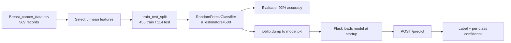

# Breast Cancer Prediction App

<p>
  
  
  
  
  
</p>

A Flask web application that classifies a breast tumour as **malignant** or **benign** from five cell-nucleus measurements, using a Random Forest trained on the Wisconsin-style breast cancer dataset.

> **Disclaimer:** this is an educational machine learning demonstration, not a medical device. It must not be used for clinical decisions.

---

## Table of Contents

- [Overview](#overview)
- [Problem Statement](#problem-statement)
- [Objectives](#objectives)
- [Features](#features)
- [Technology Stack](#technology-stack)
- [Dataset](#dataset)
- [Workflow](#workflow)
- [Installation and Setup](#installation-and-setup)
- [Dependencies](#dependencies)
- [How to Run](#how-to-run)
- [Usage Example](#usage-example)
- [Model Training and Evaluation](#model-training-and-evaluation)
- [Results](#results)
- [Limitations](#limitations)
- [Future Improvements](#future-improvements)
- [Author](#author)

---

## Overview

The project covers the full path from raw CSV to a served prediction: train a Random Forest in a notebook, persist it with `joblib`, and load it once at Flask startup so each request is a cheap in-process inference call rather than a retrain.

## Problem Statement

Given five mean-value measurements of a cell nucleus — radius, texture, perimeter, smoothness and area — predict whether the tumour is malignant or benign, and report how confident the model is in each class.

## Objectives

1. Train a reliable classifier on a small, class-imbalanced tabular dataset.
2. Persist the fitted model so inference does not require retraining.
3. Expose the model through a form-based web interface usable without Python.
4. Return calibrated per-class probabilities alongside the label, not just a bare prediction.

## Features

- Five-field web form for tumour measurements.
- Single-row inference with `predict()` and `predict_proba()`.
- Plain-language diagnosis plus a percentage confidence for each class.
- Model loaded once at startup from [`model.pkl`](./model.pkl).

## Technology Stack

| Layer | Technology |
| --- | --- |
| Model | scikit-learn `RandomForestClassifier` |
| Data | Pandas, NumPy |
| Persistence | joblib (pickle protocol 4) |
| Web | Flask, Jinja2 templates |
| Training | Jupyter Notebook (Google Colab) |

## Dataset

[`Breast_cancer_data.csv`](./Breast_cancer_data.csv) — **569 records**, committed to this repository.

| Column | Description |
| --- | --- |
| `mean_radius` | Mean distance from centre to perimeter points |
| `mean_texture` | Standard deviation of grey-scale values |
| `mean_perimeter` | Mean tumour perimeter |
| `mean_area` | Mean tumour area |
| `mean_smoothness` | Mean local variation in radius lengths |
| `diagnosis` | Target label |

**Label encoding** (verified against the data): `0` = **malignant** (212 records), `1` = **benign** (357 records) — matching the original Wisconsin Diagnostic Breast Cancer distribution. Records labelled `0` have a mean radius of 17.46 against 12.15 for class `1`, confirming that the larger tumours are the malignant class.

Class balance: 62.7% benign / 37.3% malignant.

## Workflow



## Installation and Setup

```bash
git clone https://github.com/Nithishkumar1906/ML_Projects.git
cd ML_Projects/projects/cancer-prediction-app

python -m venv .venv
source .venv/bin/activate          # Windows: .\.venv\Scripts\Activate.ps1

pip install -r requirements.txt
```

No API keys or environment variables are required — this project runs fully offline.

## Dependencies

From [`requirements.txt`](./requirements.txt):

```text
Flask==3.1.1
pandas==2.2.2
numpy==2.2.6
matplotlib==3.9.2
scikit-learn==1.7.1
joblib==1.5.1
```

> The committed `model.pkl` was pickled with scikit-learn 1.7.1. Loading it under a very different scikit-learn version may emit a version-mismatch warning; re-run [`model-training.ipynb`](./model-training.ipynb) to regenerate it if needed.

## How to Run

```bash
python app.py
```

Then open **http://127.0.0.1:5000**.

The app starts in Flask debug mode (`app.run(debug=True)`), which is intended for local development only.

## Usage Example

Submitting a large tumour through the form:

| Field | Value |
| --- | --- |
| `mean_radius` | 20.57 |
| `mean_texture` | 17.77 |
| `mean_perimeter` | 132.90 |
| `mean_smoothness` | 0.08474 |
| `mean_area` | 1326.0 |

Returns:

```text
The patient has breast cancer (malignant)
Confidence levels: 99.80% (Malignant), 0.20% (Benign)
```

Feature order matters. The app builds its `DataFrame` with the exact column order the model was fitted on (`mean_radius, mean_texture, mean_perimeter, mean_smoothness, mean_area`), which is verifiable through `model.feature_names_in_`.

## Model Training and Evaluation

Training lives in [`model-training.ipynb`](./model-training.ipynb):

1. Load the CSV with Pandas.
2. Select the five mean-value features; target is `diagnosis`.
3. `train_test_split(test_size=0.2)` → **455 train / 114 test**.
4. Fit `RandomForestClassifier(n_estimators=500, n_jobs=1)`.
5. Score with `accuracy_score` on the held-out test set.
6. Persist with `joblib.dump(model, 'model.pkl', protocol=4)`.

## Results

| Metric | Value |
| --- | --- |
| Test accuracy | **92%** |
| Test set size | 114 samples |
| Training set size | 455 samples |
| Model | Random Forest, 500 trees |

The 92% figure is the value printed in the notebook's saved output.

## Limitations

- **No fixed random seed.** `train_test_split` is called without `random_state`, so the reported accuracy shifts by a few points between runs and is not exactly reproducible.
- **Accuracy alone on imbalanced data.** With a 62.7/37.3 class split, accuracy hides which class the errors fall on. Precision, recall and a confusion matrix would be more informative — and for a cancer screening task, recall on the malignant class matters far more than overall accuracy.
- **Only 5 of 30 available features.** The full WDBC dataset provides standard-error and "worst" variants of each measurement; only the five mean values are used here.
- **No cross-validation or hyperparameter search** — `n_estimators=500` was chosen directly rather than tuned.
- **No input validation.** The form casts input with `float()`; a non-numeric entry raises an unhandled exception.
- **Debug mode** is enabled, which is unsafe for any public deployment.

## Future Improvements

- Set `random_state` and report mean accuracy across stratified k-fold cross-validation.
- Add a confusion matrix, precision/recall, ROC-AUC, and feature-importance plot.
- Train on all 30 WDBC features and compare against the 5-feature model.
- Validate and range-check form inputs, and return a friendly error page.
- Containerise with Docker and serve behind a production WSGI server.

## Fixed During Review

- **Inverted diagnosis labels (corrected).** `app.py` previously reported `prediction == 1` as "has breast cancer". In this dataset `1` is **benign** and `0` is **malignant**, so every prediction was announced backwards, and the confidence legend was swapped with it. Verified against the class distribution (212/357), the per-class feature means, and `model.classes_` before fixing.
- `requirements.txt` was empty in the original repository; it is now populated from the packages `app.py` actually imports.
- A duplicate, unused copy of `home.html` at the project root was removed (Flask only reads from `templates/`).

## Author

**Nithish Kumar M S** — AI/ML Engineer

[GitHub](https://github.com/Nithishkumar1906) · [LinkedIn](https://www.linkedin.com/in/nithish-kumar-m-s-04500626a) · [Back to portfolio](../../README.md)
