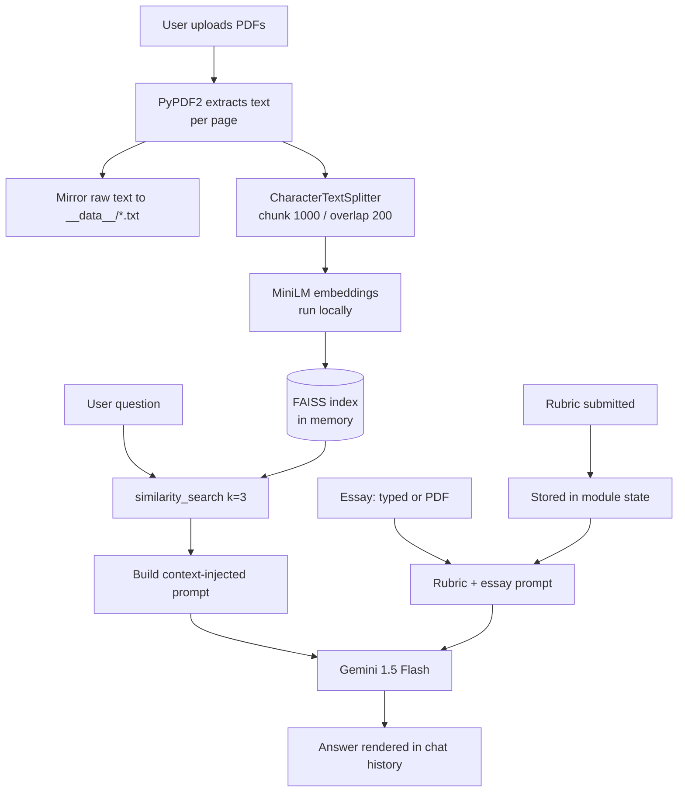

# Chat AI Assistant

<p>
  
  
  
  
  
  
</p>

A three-in-one Flask application built on Google Gemini: open-ended chat, retrieval-augmented question answering over uploaded PDFs, and rubric-based essay grading.

---

## Table of Contents

- [Overview](#overview)
- [Problem Statement](#problem-statement)
- [Objectives](#objectives)
- [Features](#features)
- [Technology Stack](#technology-stack)
- [Architecture](#architecture)
- [Installation and Setup](#installation-and-setup)
- [Dependencies](#dependencies)
- [How to Run](#how-to-run)
- [Usage Examples](#usage-examples)
- [Implementation Notes](#implementation-notes)
- [Limitations](#limitations)
- [Future Improvements](#future-improvements)
- [Author](#author)

---

## Overview

Rather than calling a prebuilt LangChain chain, this app assembles the retrieval loop by hand — PDF extraction, chunking, local embedding, FAISS similarity search, and a context-injected prompt sent straight to the Gemini SDK. LangChain is used only for its text splitter and FAISS wrapper.

Embeddings run **locally** via `sentence-transformers`; only text generation leaves the machine.

## Problem Statement

A user needs to ask questions about a document they just uploaded, hold a normal conversation, and grade written work against a rubric — without three separate tools and without an LLM inventing facts that are not in the source document.

## Objectives

1. Ground LLM answers in uploaded PDF content instead of model memory.
2. Keep embedding costs at zero by running the encoder locally.
3. Serve several distinct LLM-backed features from a single Flask application.
4. Keep credentials out of source control.

## Features

| Route | Method | Description |
| --- | --- | --- |
| `/` | GET | Landing page linking to each feature |
| `/process` | POST | Uploads one or more PDFs, extracts text with `PyPDF2`, chunks with `CharacterTextSplitter`, embeds with MiniLM, and indexes into an in-memory FAISS store |
| `/chat` | GET, POST | RAG chat over the indexed PDFs — retrieves the top 3 chunks and asks Gemini to answer from that context |
| `/pdf_chat` | GET | Upload screen for the PDF chat flow |
| `/essay_rubric` | GET, POST | Form for submitting a grading rubric |
| `/essay_grading` | GET, POST | Grades a typed or uploaded essay against the stored rubric |

Extracted PDF text is also mirrored to `.txt` files under `__data__/` for inspection.

## Technology Stack

| Layer | Technology |
| --- | --- |
| Web framework | Flask, Jinja2 |
| LLM | Google Gemini 1.5 Flash (`google-generativeai`) |
| Embeddings | `sentence-transformers/all-MiniLM-L6-v2` (local, 384-dim) |
| Vector store | FAISS (in-memory, rebuilt per upload) |
| PDF parsing | PyPDF2 |
| Chunking | LangChain `CharacterTextSplitter` — 1000 chars, 200 overlap |
| Config | python-dotenv |

## Architecture



## Installation and Setup

```bash
git clone https://github.com/Nithishkumar1906/ML_Projects.git
cd ML_Projects/projects/chat-ai-assistant

python -m venv .venv
source .venv/bin/activate          # Windows: .\.venv\Scripts\Activate.ps1

pip install -r requirements.txt
```

Create a `.env` file in this folder:

```text
GEM_API_KEY=your_gemini_api_key
```

Get a key from [Google AI Studio](https://aistudio.google.com/app/apikey). `.env` is git-ignored — never commit it.

## Dependencies

Direct dependencies, pinned in [`requirements.txt`](./requirements.txt):

```text
Flask==3.1.1                     Werkzeug==3.1.3
python-dotenv==1.1.1             PyPDF2==3.0.1
google-generativeai==0.8.5       faiss-cpu==1.11.0.post1
langchain==0.3.27                langchain-community==0.3.27
langchain-core==0.3.72           langchain-text-splitters==0.3.9
sentence-transformers==5.0.0     transformers==4.54.1
huggingface-hub==0.34.3          torch==2.7.1
```

> The first run downloads the MiniLM encoder (~90 MB) from Hugging Face and caches it locally.

## How to Run

```bash
python app.py
```

Open **http://127.0.0.1:5000**, upload a PDF via the PDF-chat flow, then ask questions about it.

## Usage Examples

**RAG chat** — upload a research paper, then ask:

```text
Q: What retrieval method does this paper propose?
```

The app embeds the question, pulls the three most similar chunks from FAISS, and sends Gemini a prompt of the form:

```text
Answer the question based on the following context:

Context:
<top-3 retrieved chunks>

Question:
What retrieval method does this paper propose?
```

**Essay grading** — submit a rubric at `/essay_rubric`, then paste an essay (or upload a PDF) at `/essay_grading`. Gemini is prompted to grade strictly against the stored rubric; newlines in the response are converted to `<br>` for HTML rendering.

## Implementation Notes

- `get_conversation_chain()` returns a **closure**, not a LangChain chain object. It performs the similarity search and prompt assembly itself — a deliberate choice to make each RAG step visible rather than hidden behind an abstraction.
- Chunking uses `separator="\n"`, so documents without newlines may produce chunks larger than the nominal 1000-character target.
- The vector store, conversation chain, chat history, and rubric are **module-level globals**, shared across all requests and all users.

## Limitations

- **Single-user state.** Globals mean a second concurrent user overwrites the first user's index, chat history and rubric. This is a single-session demo, not a multi-tenant app.
- **In-memory index.** FAISS is rebuilt on every upload and lost on restart — nothing persists.
- **No chat memory in the prompt.** `chat_history` is displayed in the UI but never fed back to Gemini, so the model cannot resolve follow-up references like "what about the second one?".
- **No citations.** Answers do not indicate which chunk or page they came from.
- **`/essay_grading` raises `UnboundLocalError` on a GET request** (a `NameError` subclass): the final `render_template(..., input_text=text)` references `text`, which is only assigned inside the POST branch. The route accepts GET, so navigating to it directly returns a 500. Verified by reproducing the control flow in isolation; left unfixed as it is a one-line change the author may want to make deliberately.
- **Unused dependencies.** `requirements.txt` previously carried `scikit-learn`, `joblib`, `openai` and `langchain-openai` as leftovers from earlier experimentation; these have now been pruned.
- **Debug mode** is enabled, which is unsafe for public deployment.

## Future Improvements

- Replace module globals with per-session state keyed by a Flask session ID.
- Persist the FAISS index with `save_local()` / `load_local()` so uploads survive a restart.
- Feed prior turns into the prompt for true multi-turn conversation.
- Return source chunk and page number with each answer.
- Guard `/essay_grading` against the GET-request `NameError`.
- Add streaming responses so long answers appear progressively.

## Fixed During Review

- **An unresolved Git merge conflict in `app.py`** had committed two unrelated applications (an old scikit-learn breast-cancer predictor and this Gemini/RAG app) under conflict markers, leaving the file a syntax error. Resolved in favour of the Gemini/RAG app, which is what the templates and dependencies actually support.
- **A live Gemini API key was hardcoded in `app.py`** and reused in `resume-analyst-bot`. It now loads from `GEM_API_KEY` via `python-dotenv`. **That key remains in this repository's Git history and should be rotated in Google AI Studio.**
- **`requirements.txt` was a 99-package `pip freeze` dump saved as UTF-16**, which `pip install -r` could not read. It is now UTF-8 and curated down to the 14 packages this app actually imports.
- Five duplicate, unused HTML files at the project root were removed (Flask only reads from `templates/`).

## Author

**Nithish Kumar M S** — AI/ML Engineer

[GitHub](https://github.com/Nithishkumar1906) · [LinkedIn](https://www.linkedin.com/in/nithish-kumar-m-s-04500626a) · [Back to portfolio](../../README.md)
