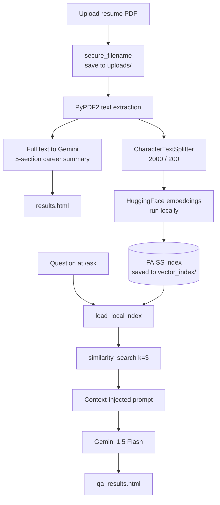

# Resume Analyst Bot

<p>
  
  
  
  
  
</p>

A Flask application that reads an uploaded resume, produces a structured career summary, and answers free-form questions about it through a FAISS-backed retrieval pipeline and Google Gemini.

---

## Table of Contents

- [Overview](#overview)
- [Problem Statement](#problem-statement)
- [Objectives](#objectives)
- [Features](#features)
- [Technology Stack](#technology-stack)
- [Architecture](#architecture)
- [Installation and Setup](#installation-and-setup)
- [Dependencies](#dependencies)
- [How to Run](#how-to-run)
- [Usage Examples](#usage-examples)
- [Implementation Notes](#implementation-notes)
- [Limitations](#limitations)
- [Future Improvements](#future-improvements)
- [Author](#author)

---

## Overview

Two complementary paths over the same document. Summarisation sends the **entire** resume to Gemini in one prompt — a resume is short enough to fit comfortably in context, and a summary needs global view. Question answering instead goes through **retrieval**, pulling only the three most relevant chunks, which keeps prompts small and answers anchored to specific sections.

The FAISS index is written to disk, so the `/ask` route works across requests and across restarts without re-uploading.

## Problem Statement

Reading a resume closely takes time, and specific questions ("how many years of Python?", "which cloud platforms?") mean re-scanning the document. The app should answer both the broad question and the narrow one from the same uploaded file.

## Objectives

1. Extract clean text from an arbitrary PDF resume.
2. Produce a consistently structured summary across five fixed career dimensions.
3. Answer arbitrary questions grounded in the resume rather than model priors.
4. Persist the vector index so retrieval survives request boundaries.

## Features

| Route | Method | Description |
| --- | --- | --- |
| `/` | GET | Resume upload form |
| `/upload` | POST | Saves the PDF, extracts text with `PyPDF2`, chunks it (2000 chars / 200 overlap), embeds it, writes a FAISS index to `vector_index/`, and asks Gemini for a structured summary |
| `/ask` | GET, POST | Loads the saved index, retrieves the top 3 chunks for the question, and asks Gemini to answer from that context |

The summary prompt casts Gemini as an "AI Career Coach" and requests five fixed sections: career objective, skills and expertise, professional experience, educational background, and notable achievements.

## Technology Stack

| Layer | Technology |
| --- | --- |
| Web framework | Flask, Jinja2, Werkzeug (`secure_filename`) |
| LLM | Google Gemini 1.5 Flash (`google-generativeai`) |
| Embeddings | LangChain `HuggingFaceEmbeddings` (local, default MiniLM) |
| Vector store | FAISS, persisted to `vector_index/` |
| PDF parsing | PyPDF2 |
| Chunking | LangChain `CharacterTextSplitter` — 2000 chars, 200 overlap |
| Config | python-dotenv |

## Architecture



## Installation and Setup

```bash
git clone https://github.com/Nithishkumar1906/ML_Projects.git
cd ML_Projects/projects/resume-analyst-bot

python -m venv .venv
source .venv/bin/activate          # Windows: .\.venv\Scripts\Activate.ps1

pip install -r requirements.txt
```

Create a `.env` file in this folder:

```text
GEMINI_API_KEY=your_gemini_api_key
```

Get a key from [Google AI Studio](https://aistudio.google.com/app/apikey). `.env` is git-ignored — never commit it.

## Dependencies

Direct dependencies, pinned in [`requirements.txt`](./requirements.txt):

```text
Flask==3.1.1                     Werkzeug==3.1.3
python-dotenv==1.1.1             PyPDF2==3.0.1
google-generativeai==0.8.5       faiss-cpu==1.11.0.post1
langchain==0.3.27                langchain-community==0.3.27
langchain-core==0.3.72           langchain-text-splitters==0.3.9
sentence-transformers==5.0.0     transformers==4.54.1
huggingface-hub==0.34.3          torch==2.7.1
```

> The first run downloads the embedding model (~90 MB) from Hugging Face and caches it locally.

## How to Run

```bash
python app.py
```

Open **http://127.0.0.1:5000**, upload a resume PDF to get the summary, then visit `/ask` to query it.

## Usage Examples

**Upload** → returns a structured summary:

```text
Career Objective: ...
Skills and Expertise: ...
Professional Experience: ...
Educational Background: ...
Notable Achievements: ...
```

**Ask** → retrieval-grounded answers:

```text
Q: Which vector databases has this candidate worked with?
Q: What was the measured accuracy of the pneumonia classifier?
Q: How long was the internship?
```

Each question triggers a `similarity_search(query, k=3)` against the persisted index; only those three chunks are sent to Gemini as context.

## Implementation Notes

- `FAISS.load_local(..., allow_dangerous_deserialization=True)` is required because FAISS indexes are unpickled. This flag is safe **only** for indexes you generated yourself — never point it at an index from an untrusted source.
- The index is rebuilt and **overwritten** on every upload, so exactly one resume is queryable at a time.
- `secure_filename()` is applied to uploads, preventing path-traversal filenames.
- Chunk size is 2000 characters here against 1000 in [`chat-ai-assistant`](../chat-ai-assistant/) — resumes are short and benefit from fewer, larger chunks that keep a whole role or section intact.

## Limitations

- **Single-document, single-user.** One shared `vector_index/` on disk means a second upload replaces the first, for everyone.
- **`/ask` fails before any upload.** `FAISS.load_local` raises if `vector_index/` does not exist yet; there is no friendly "upload a resume first" guard.
- **Layout-sensitive extraction.** `PyPDF2` struggles with multi-column and heavily styled resumes; text can arrive interleaved, which degrades both summary and retrieval quality.
- **Newline-based chunking.** `separator="\n"` means a resume exported without newlines can produce chunks well over the 2000-character target.
- **No citations** — answers do not say which section they came from.
- **`templates/query_results.html` is unreferenced** by any route in `app.py`, a leftover from earlier development.
- **Debug mode** is enabled, which is unsafe for public deployment.

## Future Improvements

- Namespace indexes per session so multiple resumes coexist.
- Redirect to the upload page when `vector_index/` is missing instead of raising.
- Swap `PyPDF2` for `pdfplumber` or `PyMuPDF` to handle multi-column layouts.
- Add structured extraction (years of experience, skill list, education) as JSON alongside prose.
- Support DOCX in addition to PDF.
- Add a relevance score threshold so clearly unrelated questions return "not found in this resume" rather than a hallucinated answer.

## Fixed During Review

- **A live Gemini API key was hardcoded in `app.py`** — the same key reused in [`chat-ai-assistant`](../chat-ai-assistant/). It now loads from `GEMINI_API_KEY` via `python-dotenv`. **That key remains in this repository's Git history and should be rotated in Google AI Studio.**
- **`requirements.txt` was a 99-package `pip freeze` dump saved as UTF-16**, which `pip install -r` could not read. It is now UTF-8 and curated to the 14 packages this app actually imports.
- The tracked `vector_index/` files were removed as regenerable build artifacts, and both `vector_index/` and `uploads/` are now covered by `.gitignore`.

## Privacy Note

`uploads/` previously contained three real resume PDFs used as test fixtures, carrying a real name,
phone number and email address. **They have been removed from the working tree** and the folder is now
kept empty via `.gitkeep`, with `uploads/` covered by [`.gitignore`](../../.gitignore) so future uploads
are never committed.

**They remain in this repository's Git history.** Removing them from history requires a rewrite
(`git filter-repo` or BFG) followed by a force-push — do that before treating this repository as a
public portfolio. The same applies to the API keys listed above.

## Author

**Nithish Kumar M S** — AI/ML Engineer

[GitHub](https://github.com/Nithishkumar1906) · [LinkedIn](https://www.linkedin.com/in/nithish-kumar-m-s-04500626a) · [Back to portfolio](../../README.md)
